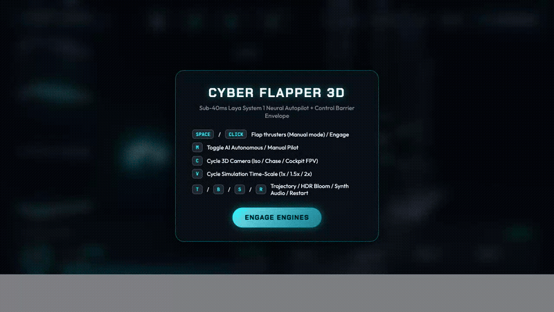
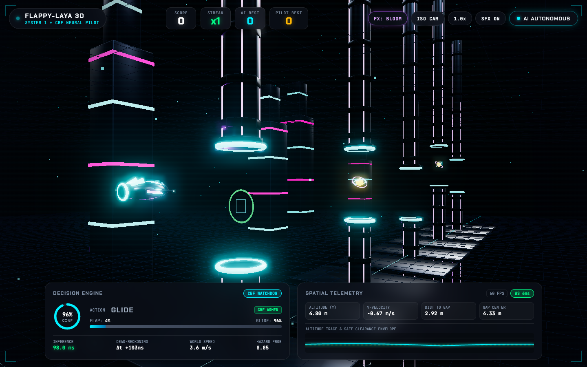
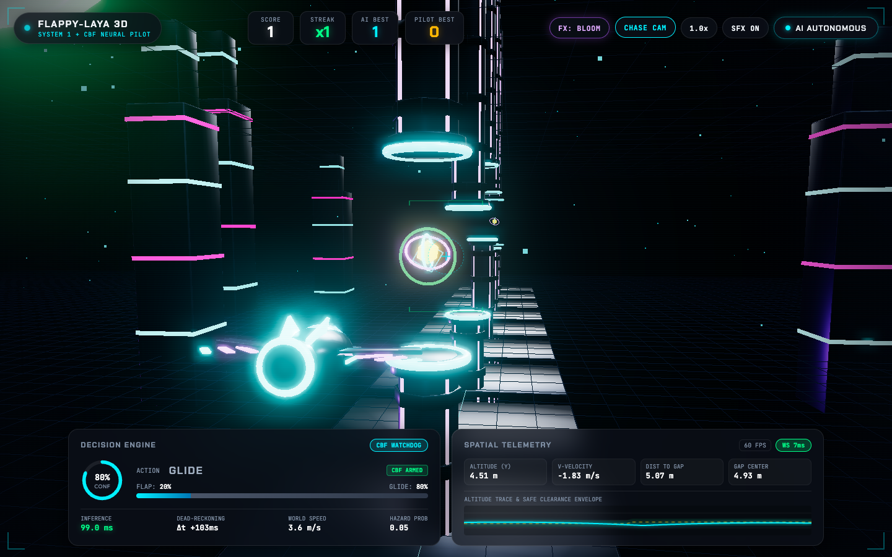
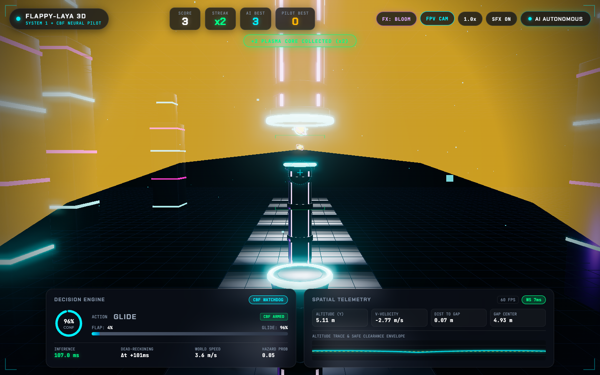
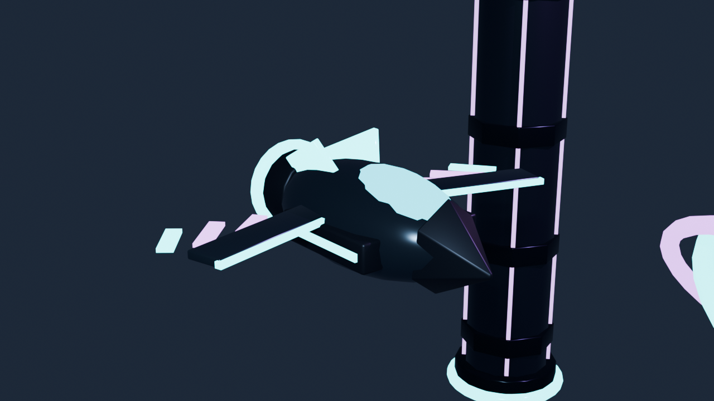

# 3D Flappy Bird with System 1 AI Autonomous Player (Laya + Three.js + NestJS + Headless Blender MCP)

An ultra-responsive, containerized **Cyberpunk Mecha-Avian 3D Game** driven by a non-autoregressive **System 1 Decision Engine** powered by **Laya** (`NandhaKishorM/laya`), a **Control Barrier Function (CBF) Kinematic Safety Envelope**, and a **Headless Blender MCP (`sandraschi/blender-mcp`) 3D PBR Asset Pipeline**.

---

## 🎬 Live Gameplay Video & Screenshots

### Autonomous AI Gameplay (`ISO CAM` → `CHASE CAM` → `FPV CAM`)



> 🎥 **Full HD MP4 Gameplay Video:** [Watch / Download `docs/gameplay.mp4`](docs/gameplay.mp4)

<video src="docs/gameplay.mp4" controls width="100%" muted loop playsinline></video>

### Multi-Camera Perspectives & Blender MCP Studio Showcase

| Isometric Tactical View (`ISO CAM`) | Over-The-Shoulder Chase (`CHASE CAM`) |
| :---: | :---: |
|  |  |
| **First-Person Cockpit (`FPV CAM` + Plasma Shockwave)** | **Headless `blender-mcp` 3D Assets Showcase** |
|  |  |

---

## ⚡ Highlights

* **Headless Blender MCP (`sandraschi/blender-mcp`) 3D Asset Pipeline:** Procedurally authors, shades (multi-slot Principled BSDF PBR + emissive neon), and exports 4 game-ready binary glTF 2.0 (`.glb`) 3D models (`mecha_bird.glb`, `cyber_pipe.glb`, `plasma_orb.glb`, `cyber_city.glb`) using headless Blender (`--background`).
* **Three.js HDR Post-Processing & PBR IBL Pipeline:** Combines `GLTFLoader` zero-GC instance pooling, `PMREMGenerator` + `RoomEnvironment` metallic specular reflections, and `EffectComposer` + `UnrealBloomPass` (selective HDR bloom with runtime `B` key / `FX: BLOOM` toggle).
* **Sub-40ms System 1 AI + CBF Safety Shield:** Combines single-pass ModernBERT semantic routing (`Laya`) with a deterministic Control Barrier Function (CBF) envelope that mathematically prevents upper-pipe ceiling breaches and floor crashes.
* **Adaptive RTT Dead-Reckoning Compensation:** Projects bird kinematics (`g = -14.0 m/s²`, `v_flap = 5.4 m/s`) forward by measured WebSocket RTT + EMA inference latency (`Δt`), with multi-pipe lookahead target blending.
* **Procedural Web Audio Synthesizer:** Zero-dependency Web Audio API synth engine generating thruster sweeps, harmonic combo chimes, plasma orb triads, near-miss arcs, and sub-bass impact drops.
* **Zero-Downtime Edge CBF Autopilot:** Seamlessly falls back to a client-side 60 FPS kinematic CBF controller if the WebSocket gateway or Python service is offline.
* **Cyberpunk Tactical Cockpit HUD:** Diegetic scanline/vignette framing, fighter-jet pitch ladder & crosshair reticle in `CHASE`/`FPV` views, real-time confidence gauge, live WS RTT & FPS counters, safe-corridor envelope sparkline, and separate `AI BEST` vs `PILOT BEST` leaderboards.

---

## 🎨 Headless Blender MCP (`sandraschi/blender-mcp`) 3D Asset Pipeline

This project integrates **[`sandraschi/blender-mcp`](https://github.com/sandraschi/blender-mcp)** in **headless mode** (`BlenderExecutor` with `--background --factory-startup`) to generate all 3D models and PBR materials without opening a GUI window.

### Generated `.glb` Assets (`services/frontend/public/models/`)

| Asset | File | Node Hierarchy | Description |
| :--- | :--- | :--- | :--- |
| **Mecha-Falcon Drone** | `mecha_bird.glb` | `Chassis`, `Visor`, `DorsalFin_L/R`, `LeftWing`, `RightWing`, `ThrusterCore` | Sleek titanium stealth fuselage, wraparound cyan visor, V-tail stabilizers, 4 fanned plasma feather blades per wing, and pulsing vector exhaust nozzle. |
| **Reactor Conduit Pipe** | `cyber_pipe.glb` | `ConduitColumn`, `ArmorRib_0..6`, `PlasmaStrip_0..3`, `CollarRing`, `CollarGlow` | 12m octagonal industrial reactor column with heavy structural ribs, vertical plasma strips, and a mechanical containment collar that switches from **Neon Cyan** to **Neon Emerald** once cleared. |
| **Quantum Plasma Core** | `plasma_orb.glb` | `Core`, `InnerRing`, `OuterRing` | Counter-rotating multi-ring gyroscope surrounding a faceted golden-amber icosahedral energy core. |
| **Cyberpunk Megastructure** | `cyber_city.glb` | `Megastructure`, `MegastructureSpire`, `NeonBand_0..4`, `TrenchPlate` | Parallax background skyscraper clusters with alternating cyan/magenta neon bands and scrolling industrial trench floor plating. |

### Rebuilding 3D Assets Headlessly via `blender-mcp`

1. **MCP Client Configuration (`.mcp.json`):**
   ```json
   {
     "mcpServers": {
       "blender-mcp": {
         "command": "uv",
         "args": ["--directory", "./tools/blender-mcp", "run", "blender-mcp-server"],
         "env": {
           "BLENDER_EXECUTABLE": "/Applications/Blender.app/Contents/MacOS/Blender"
         }
       }
     }
   }
   ```

2. **Generate All `.glb` Assets & Studio Render:**
   ```bash
   uv run --with psutil --with pydantic python3 scripts/generate_assets_via_blender_mcp.py
   ```

3. **Verify `.glb` Binary Headers, Meshes & PBR Materials:**
   ```bash
   python3 scripts/test_glb_assets.py
   ```

---

## 🏗️ System Architecture

```
+-----------------------------------------------------------------------------------+
|                HEADLESS BLENDER MCP PIPELINE (sandraschi/blender-mcp)             |
|                                                                                   |
|  [generate_assets_via_blender_mcp.py] ---> [BlenderExecutor (blender --background)]|
|         |                    |                       |                   |        |
|         v                    v                       v                   v        |
|  mecha_bird.glb       cyber_pipe.glb         plasma_orb.glb      cyber_city.glb   |
+-----------------------------------------------------------------------------------+
                                       |
                                       v  (Static Assets in public/models/*.glb)
+-----------------------------------------------------------------------------------+
|                                 USER BROWSER                                      |
|                                                                                   |
|  +--------------------+    Input / Audio    +----------------------------------+  |
|  | Three.js + Bloom   | <-----------------> | Tactical Cockpit HUD & Synth SFX |  |
|  | - GLTFLoader Pool  |                     | - Confidence & CBF Shield Status |  |
|  | - UnrealBloomPass  |                     | - Safe-Corridor Envelope Graph   |  |
|  | - Iso/Chase/FPV Cam|                     | - FPV Pitch Ladder & Crosshair   |  |
|  +---------+----------+                     +-----------------+----------------+  |
|            |                                                  ^                   |
|            v (Client CBF Shield & Edge Fallback)              |                   |
+------------|--------------------------------------------------|-------------------+
             | (WebSocket: State Tick + RTT @ 18Hz)             |
             v                                                  |
+-----------------------------------------------------------------------------------+
|                        NESTJS APPLICATION GATEWAY (Node.js)                       |
|                                                                                   |
|  +-----------------------------------------------------------------------------+  |
|  | Game Gateway (Socket.io + Live RTT Ping/Pong)                               |  |
|  +-------------------------------------+---------------------------------------+  |
|                                        |                                          |
|                                        v                                          |
|  +-----------------------------------------------------------------------------+  |
|  | Adaptive Dead-Reckoning & Multi-Pipe Lookahead Compensator                  |  |
|  | (Projects bird state forward by 0.5 * RTT + EMA_Inference_Ms)               |  |
|  +-------------------------------------+---------------------------------------+  |
|                                        |                                          |
|                                        v                                          |
|  +-----------------------------------------------------------------------------+  |
|  | Laya Client Adapter (HTTP Keep-Alive Pool) & CBF Safety Watchdog            |  |
|  +-------------------------------------+---------------------------------------+  |
+----------------------------------------|------------------------------------------+
                                         | HTTP Keep-Alive (Port 8000)
                                         v
+-----------------------------------------------------------------------------------+
|                        LAYA DECISION SERVICE (Python 3.11)                        |
|                                                                                   |
|  +-----------------------------------------------------------------------------+  |
|  | FastAPI (/v1/systemone/predict)                                             |  |
|  +-------------------------------------+---------------------------------------+  |
|                                        |                                          |
|                                        v                                          |
|  +-----------------------------------------------------------------------------+  |
|  | Laya Router Checkpoint (ModernBERT 421M / mmBERT 322M) + CBF Verification   |  |
|  | Single forward pass returning: choice + confidence + hazard + cbf_override  |  |
|  +-----------------------------------------------------------------------------+  |
+-----------------------------------------------------------------------------------+
```

---

## 🚀 Quickstart with Docker Compose

To build and start all 3 services in one command:

```bash
docker compose up --build
```

Then open your browser:
* **Frontend Web Application:** [http://localhost:5173](http://localhost:5173)
* **Backend Gateway & Health:** [http://localhost:3000/health](http://localhost:3000/health)
* **Laya Decision API Docs:** [http://localhost:8000/docs](http://localhost:8000/docs)

---

## 💻 Local Development Setup

### 1. AI Decision Service (Python 3.11)
```bash
cd services/ai-engine
python3 -m venv .venv
source .venv/bin/activate
pip install -r requirements.txt
python app.py
```

### 2. Backend Gateway (NestJS)
```bash
cd services/backend
npm install
npm run start:dev
```

### 3. Frontend Web App (Three.js + Vite)
```bash
cd services/frontend
npm install
npm run dev
```

---

## 🎮 Controls

* **`SPACE` / `CLICK` / `TAP`:** Flap thrusters (Manual mode) / Start / Restart
* **`M`:** Switch between AI Autonomous Mode and Manual Pilot Mode
* **`C`:** Cycle 3D Camera Perspective (`ISO CAM` / `CHASE CAM` / `FPV CAM`)
* **`B`:** Toggle HDR `UnrealBloomPass` Post-Processing (`FX: BLOOM` / `FX: RAW`)
* **`V`:** Cycle Simulation Time-Scale (`1.0x` / `1.5x` / `2.0x`)
* **`T`:** Toggle 3D Predictive Trajectory Projection & Target Reticle
* **`S`:** Mute / Unmute Procedural Web Audio Synthesizer
* **`R`:** Instant Mission Restart
